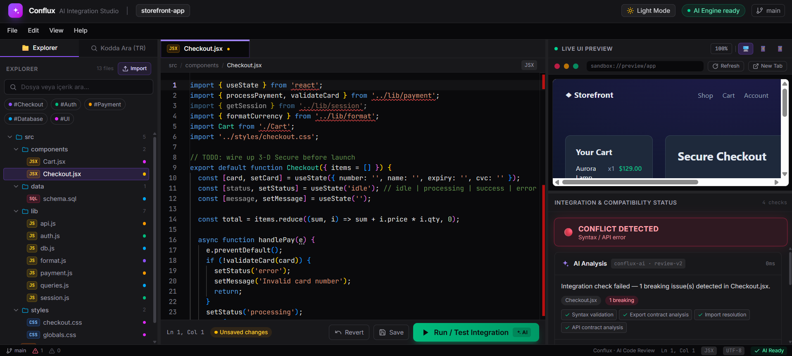
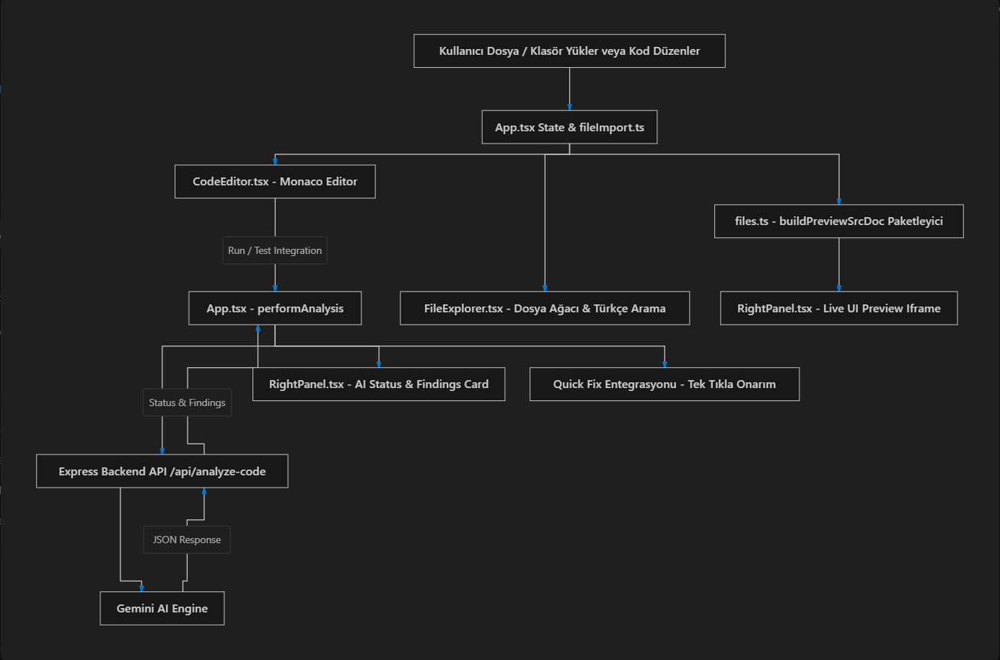

# ConFlux DevTool — AI-Powered Code Review & Live Integration Studio 🚀
[](https://www.typescriptlang.org/)
[](https://reactjs.org/)
[](https://vitejs.dev/)
[](https://tailwindcss.com/)
[](https://microsoft.github.io/monaco-editor/)
[](https://deepmind.google/technologies/gemini/)

**ConFlux DevTool** is a next-generation web IDE and Static Code Reviewer powered by Google's Gemini AI. It provides real-time integration compatibility checks, automated HTML/CSS/JS live UI bundling, Turkish semantic code search, and a full Monaco Editor development studio.
---
## 📸 Interface Preview

---
## 🏗️ System Architecture

---
## ✨ Key Features
### 🤖 1. AI-Powered Code Review & Integration Analysis
- **Real-Time Integration Testing**: Click **"Run / Test Integration"** to evaluate syntax correctness, breaking changes, undefined imports, and API contract mismatches.
- **Strict JSON Response Format**: Powered by Google Gemini AI with guaranteed structured outputs (`COMPATIBLE` vs `CONFLICT_DETECTED`).
- **One-Click Quick Fixes**: Instantly apply AI-suggested code fixes into the active file with automatic re-analysis.
### 🖥️ 2. Interactive Live UI Preview Engine
- **Automated Dependency Bundling**: Automatically scans HTML files for `<link rel="stylesheet">` and `<script src="...">` tags and inlines all project CSS/JS files into a standalone preview sandbox.
- **Custom Project Support**: Load custom multi-file web apps (e.g., HTML/CSS/JS memory card games, interactive forms) with full interactive script execution.
- **Responsive Viewports & Zoom Modes**: Switch between **Desktop**, **Tablet**, and **Mobile** viewports with **100% (1:1)** or **Fit (85%)** zoom toggles.
### 🔍 3. Turkish-Supported Semantic Code Search
- **Character Normalization**: Seamlessly handles Turkish characters (`ç, ğ, ı, ö, ş, ü`).
- **Domain Synonym Mapping**: Converts natural Turkish queries (e.g., `"kart eşleştirme fonksiyonu"`) to relevant code symbols (`kart`, `card`, `match`, `flip`, `pair`, `esles`, `checkmatch`, `function`, `const`).
- **One-Click Jump to Line**: Search results show line numbers (`L42`) and snippet previews. Clicking a result opens the file and scrolls Monaco Editor directly to the target line.
### 📝 4. Professional Monaco IDE Experience
- Multi-tab file switching with unsaved changes indicators (`●`).
- File path breadcrumb bar and language badges.
- Connected **Edit Menu**: Full keyboard and menu support for `Undo (Ctrl+Z)`, `Redo (Ctrl+Y)`, `Select All (Ctrl+A)`, and `Find (Ctrl+F)`.
### 📁 5. Dynamic Project Import & Header Cleanup
- Automatically detects the uploaded folder/project name (e.g., `memory-card-game`).
- Sleek, uncluttered header without static avatar placeholders.
### 🌓 6. Dark Mode & Light Mode Theme Support
- Full dark/light theme switching for the entire UI and Monaco Editor (`vs-dark` vs `vs`).
- State is automatically persisted in `localStorage`.
---
```text
├── docs/                      # Documentation images (preview.png & architecture.png)
├── server/                    # Express backend server for Gemini AI API
│   └── index.js               # /api/analyze-code endpoint
├── src/
│   ├── components/
│   │   ├── CodeEditor.tsx     # Monaco Editor component & actions handle
│   │   ├── FileExplorer.tsx   # Sidebar Explorer & Turkish Code Search tab
│   │   ├── Header.tsx         # Top bar with dynamic project title & theme toggle
│   │   ├── MenuBar.tsx        # Application menu bar (File, Edit, View, Help)
│   │   ├── RightPanel.tsx     # Live UI Preview iframe & AI Status panel
│   │   ├── StatusBar.tsx      # Bottom status bar
│   │   └── icons.tsx          # SVG icon collection
│   ├── data/
│   │   └── files.ts           # Sample project files & buildPreviewSrcDoc bundler
│   ├── lib/
│   │   ├── analyze.ts         # Local static fallback analyzer & API pipeline
│   │   └── highlight.ts       # Code highlighting utilities
│   ├── utils/
│   │   ├── cn.ts              # Tailwind class merging utility
│   │   └── fileImport.ts      # Browser folder & file upload processor
│   ├── App.tsx                # Main IDE application state manager
│   ├── index.css              # Tailwind CSS styles & Dark/Light mode overrides
│   ├── main.tsx               # Application entry point
│   └── types.ts               # TypeScript interfaces & types
├── index.html
├── package.json
├── tsconfig.json
└── vite.config.ts
```
```
PORT=3001
```
### 4. Run Development Server
Start the Vite frontend and Express backend concurrently:
```bash
npm run dev
```
Open your browser and navigate to `http://localhost:5173`.
### 5. Build for Production
```bash
npm run build
```
---
## 📡 API Contract (`/api/analyze-code`)
### Request Payload
```json
{
  "code": "export function matchCards(cardA, cardB) { return cardA.id === cardB.id; }",
  "filePath": "src/components/GameBoard.jsx",
  "category": "UI"
}
```
### Response Output
```json
{
  "status": "COMPATIBLE",
  "has_breaking_changes": false,
  "summary": "Kart eşleştirme fonksiyonu başarıyla doğrulandı, herhangi bir yazım veya sözdizimi hatası bulunamadı.",
  "findings": [
    {
      "severity": "INFO",
      "title": "Kod Yapısı Uyumlu",
      "description": "Fonksiyon girdi parametrelerini güvenli bir şekilde karşılaştırıyor.",
      "quick_fix": "Ekstra tip kontrolü için strict equality (===) kullanımına devam edin."
    }
  ]
}
```
---
## 📜 License
This project is open-source and available under the [MIT License](LICENSE).
